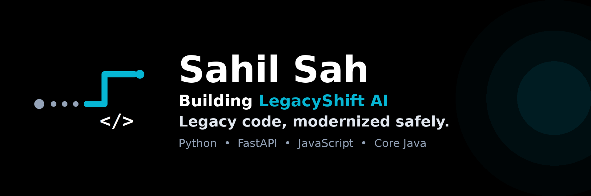

# Hi, I'm Sahil Sah
Founder & CEO, LegacyShift AI — modernizing legacy code safely.

- Building LegacyShift AI, from its original Python modernizer to a broader product for teams on old, business-critical code
- Selected for SIH 2nd round (Smart India Hackathon, college level)
- 3rd place, Kaggle battery-health datathon, team Super intelligence
- ISBM / SPPU Computer Engineering, Pune, India
- Skills: Python, FastAPI, JavaScript, Core Java, Git, GitHub, HTML, CSS
- LinkedIn: https://www.linkedin.com/in/sahil-sah-96079a316
- GitHub: https://github.com/SahilSah00098
